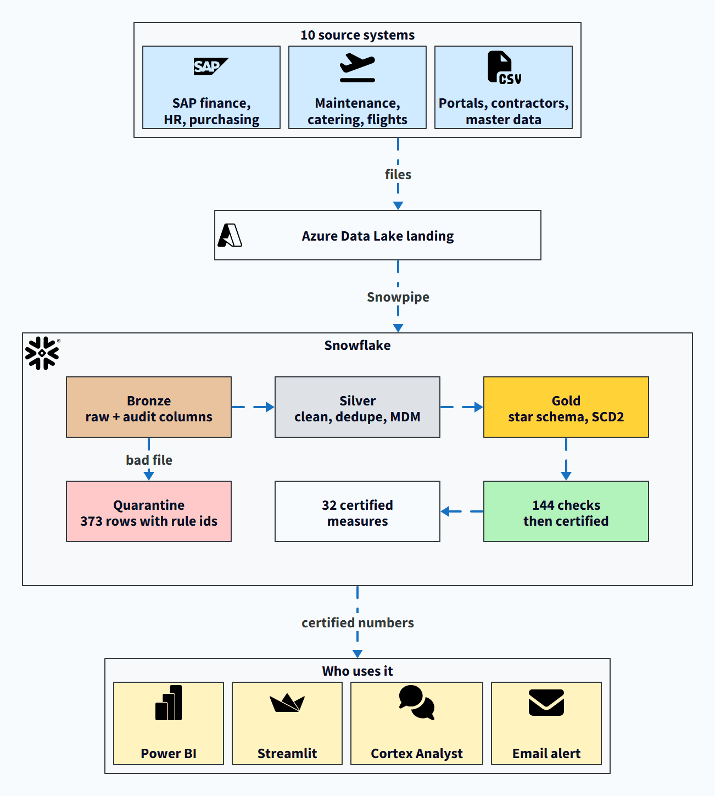

# Airport services EDW demo

An end-to-end Snowflake data platform for a fictional airport ground-handling and catering group, **Airport Services Co. (ASC)**.
Ten source systems land in Bronze, are cleaned in Silver and modelled into a Gold star schema, then served to Power BI,
a Streamlit app and Cortex Analyst, with reconciliation, data-quality quarantine and row-level security on the way.

All data is synthetic and generated (seed 42): the company, airport, airline (Gulfway Airways), people, vendors and numbers.



## Why this matters

Moving data into a warehouse is the easy part. The hard part is being able to say the number on the dashboard is right.
Here every Gold number is rebuilt from the raw Bronze extracts, checked back against them (144 checks), and only then
stamped as certified. A bad file never gets past Bronze: it is rejected and its rows are quarantined with the rule they broke.

You can take the whole thing apart: the generator, the SQL in run order, the expected results, and a walkthrough of each step.

The limit to know about: the orchestration is scripts you run in order. Snowpipe loads new files into Bronze on its own,
but Silver and Gold are only rebuilt when you run `03` and `04` again; there is no scheduler wired in.

## What it shows

- **Medallion layers:** only Bronze is loaded from files; Silver and Gold are always built from Bronze by SQL.
- **Data quality:** a malformed contractor file is rejected and its bad rows quarantined with rule ids; the corrected file loads.
- **Master data:** 97 vendor records resolved to 80 golden vendors.
- **History:** SCD2 asset dimension (tug T-114 changes cost centre and status).
- **Reconciliation:** 144 checks of Gold against the sources (142 pass, 2 info), then a certification stamp.
- **Security:** persona roles with row access and masking policies.
- **Consumption:** Power BI report, Streamlit app, Cortex Analyst semantic view.
- **Automation:** ADLS Gen2 landing zone with Snowpipe, a live SITA feed (streams and tasks), and an email alert when meal wastage passes 4%.

## Repo layout

```
generate_data.py   regenerates data/ (deterministic)
verify_pack.py     checks CSVs against the DDL, foreign keys and the expected story numbers
data/              bronze/ (source extracts), bad_files/ (quarantine demo), gold/ (expected results, never loaded)
sql/               01-11, run in order (see below)
azure/             ADLS Gen2 landing zone setup and upload scripts
powerbi/           Power BI project (.pbip), measures.dax, model_notes.md
streamlit/         Streamlit in Snowflake app and deploy.sql
docs/              walkthrough.md: the platform step by step, with the queries to run
```

## Run it

1. **Set your values.** The repo has no account details; replace these placeholders:
   - `<SNOWFLAKE_ACCOUNT>`: the `SnowflakeServer` parameter in Power BI
   - `<AZURE_TENANT_ID>`: `sql/01b_adls_integration.sql`
   - `<ALERT_EMAIL>`: `sql/11_wastage_alert.sql` (an address verified on a Snowflake user)
2. **Set up Snowflake:** `sql/01_snowflake_setup.sql` as ACCOUNTADMIN.
3. **Upload the files** to the landing stage:
   ```
   PUT file://<repo>/data/bronze/*.csv    @EDW_BRONZE.LANDING.STG_SOURCE_DROP/bronze/    AUTO_COMPRESS=FALSE;
   PUT file://<repo>/data/bad_files/*.csv @EDW_BRONZE.LANDING.STG_SOURCE_DROP/bad_files/ AUTO_COMPRESS=FALSE;
   ```
   Or use the ADLS landing zone instead (below).
4. **Build:** run `04_gold_model.sql` up to `-- LOADS FROM SILVER`, then `02`, `03`, `04`, `05`, `06`, `07`, `08b`.
5. **Optional:** `10_live_pipeline.sql` (live SITA feed), `11_wastage_alert.sql` (email alert, created suspended),
   `streamlit/deploy.sql` (the app; upload the `streamlit/` files to its stage as the file explains).
6. **Power BI:** open `powerbi/ASC_Group_Performance.pbip`, set `SnowflakeServer`, sign in, refresh.

To regenerate the data: `python -I generate_data.py && python -I verify_pack.py`.

### ADLS Gen2 landing zone (optional)

`azure/01_setup_adls.sh` creates the storage account, container, queue and Event Grid subscription; `sql/01b` creates the
Snowflake integrations; `azure/02_grant_snowflake.sh` grants their roles; `azure/03_upload.sh` uploads the files.
Then run `sql/01c_adls_stages.sql` before the load, and `sql/02b_snowpipe.sql` after it: a file dropped into
`landing/bronze/` is loaded into Bronze within about a minute. Pick your own storage account name if `edwdemolanding` is taken.

## Results (measured on Snowflake)

| | |
|---|---|
| Full rebuild, empty account to certified Gold | 193 s on a Medium warehouse |
| Bronze objects loaded | 28, one Snowpipe pipe each |
| Reconciliation checks | 144: 142 pass, 2 info (vendor 97 to 80, quarantined 373 / accepted 370) |
| Group revenue, Jan 2025 to Sep 2026 | USD 148,217,435, the same in Gold and in the source |

## Story numbers in the data

- Group revenue FY2025 USD 84.2M (EBITDA 24.0%), FY2026 to September USD 64.0M (22.8%)
- Gulfway Airways Europe meal wastage, Sep 2026: 4.58% (from 3.14% in August), the route that crosses the 4% line this month
- Cost per meal Q3 vs Q2 FY26: Emirates +13.2%, flydubai +13.1%, Charter +12.4%, all others under 1%
- Contractor overtime at ASC Workforce Services: +318 hours from August to September
- Tug T-114 downtime cost, Sep 2026: USD 4,658

`data/control_totals.json` has the full set; `docs/walkthrough.md` shows where each one comes from.

## Not covered

- **Scheduling.** Silver and Gold are rebuilt by running the scripts, not by tasks on a timer (only the SITA live feed runs on tasks).
- **The wastage alert checks only the latest month.** If a new month lands before the alert has run, last month's breach is never emailed.
- **Synthetic data.** Volumes and prices are plausible but invented, and some history is thinned to keep the repo small (see `docs/walkthrough.md`).
